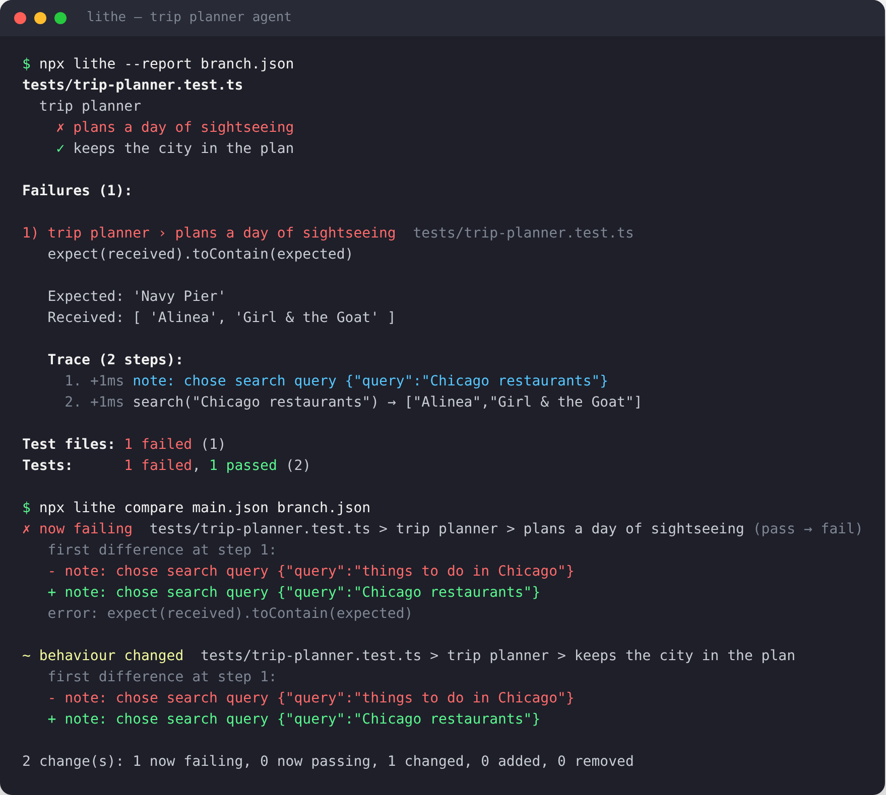

# Lithe

[](https://www.npmjs.com/package/@thedejo/lithe)
[](https://www.npmjs.com/package/@thedejo/lithe)
[](https://github.com/TheDejo/lithe/actions/workflows/ci.yml)
[](LICENSE)

**Test your AI agents like real software.**

Lithe is an open-source, Jest-style test runner built for AI agents and LLM-powered code. Write tests in TypeScript or JavaScript, mock your LLM and tools, assert on *meaning* instead of exact wording, retry flaky model calls, and gate your CI on the result. When an agent's behaviour changes, Lithe shows you **what it did differently, step by step**.



```bash
npm install --save-dev @thedejo/lithe
```

**Website:** [thedejo.github.io/lithe-site](https://thedejo.github.io/lithe-site/)

Works with any LLM provider, including the [Anthropic](examples/integrations/anthropic-sdk.test.ts) and [OpenAI](examples/integrations/openai-sdk.test.ts) SDKs.

```ts
import { test, expect } from "@thedejo/lithe";

test("recommends frontend roles", async () => {
  const result = await jobAgent("frontend jobs in New York");

  expect(result.jobs).toContain("Frontend Developer");
  expect(result.summary).toContainAny(["react", "frontend", "ui"]);
});
```

```text
$ npx lithe

tests/jobs.test.ts
  ✓ recommends frontend roles (812ms)

Test files: 1 passed (1)
Tests:      1 passed (1)
Time:       1.02s
```

---

## Contents

- [Why Lithe](#why-lithe)
- [Quick start](#quick-start)
- [Writing tests](#writing-tests)
- [Testing agents](#testing-agents)
- [Assertions reference](#assertions-reference)
- [Mocks](#mocks)
- [Semantic assertions](#semantic-assertions)
- [Record and replay](#record-and-replay)
- [Traces and run records](#traces-and-run-records)
- [CLI reference](#cli-reference)
- [Running in CI/CD](#running-in-cicd)
- [Developing Lithe](#developing-lithe)
- [Stability](#stability)
- [Roadmap](#roadmap)
- [Contributing](#contributing)

---

## Why Lithe

AI systems are powerful, but hard to trust:

- Outputs change between runs
- Prompts behave unpredictably
- Multi-step agents are difficult to validate
- Small changes cause silent regressions

Lithe gives you the tools of a normal test runner, plus the ones agents need:

| Capability                                    | Lithe |
| --------------------------------------------- | ----- |
| Code-first tests (TS & JS, zero config)       | ✅    |
| Multi-step / tool-calling agent tests         | ✅    |
| Mock LLM clients and tools (`fn`, `spyOn`)    | ✅    |
| Fuzzy assertions for non-deterministic output | ✅    |
| Per-test timeouts and automatic retries       | ✅    |
| Step-by-step traces of what the agent did     | ✅    |
| Run records you can diff across commits       | ✅    |
| CI-friendly exit codes                        | ✅    |

---

## Quick start

**Requirements:** Node.js 20 or newer.

### 1. Install

```bash
npm install --save-dev @thedejo/lithe
```

> Note the `@thedejo/` scope: the unscoped `lithe` package on npm is an unrelated project.

### 2. Add a test script to `package.json`

```json
{
  "scripts": {
    "test": "lithe"
  }
}
```

### 3. Write a test

Create any file ending in `.test.ts`, `.test.js`, `.spec.ts` or similar (`.mts`, `.cts`, `.mjs`, `.cjs`, `.tsx`, `.jsx` work too):

```ts
// tests/greeting.test.ts
import { test, expect } from "@thedejo/lithe";

async function agent(input: string) {
  return { reply: `Hello, ${input}!` };
}

test("greets the user by name", async () => {
  const result = await agent("Ada");
  expect(result.reply).toContain("Ada");
});
```

TypeScript works out of the box. You don't need `ts-node`, a build step or a `tsconfig` change.

### 4. Run

```bash
npm test
```

Lithe finds every test file under the current directory, skipping `node_modules`, `dist`, `build`, `coverage`, `out` and dot-folders. It prints results and exits with code `1` if anything failed.

While you work, keep it running in watch mode. It re-runs the tests whenever you save a file:

```bash
npx lithe --watch
```

Press Enter to run again, or `q` to quit. Each run starts fresh, so edits to your agent and your tests are always picked up.

With many test files, run several at once:

```bash
npx lithe --jobs 4
```

Each file runs in its own process. Output is printed one file at a time, so it never interleaves, and failures, the summary, `--report` and `--junit` cover every file. `--jobs auto` uses one process per CPU core, minus one. Tests within a file still run in order, so hooks and shared state work as usual.

---

## Writing tests

### `test` / `it`

```ts
import { test, it } from "@thedejo/lithe";

test("name", async () => { /* ... */ });
it("is an alias of test", () => { /* ... */ });

test("slow LLM call", async () => { /* ... */ }, 30_000);        // timeout in ms
test("flaky LLM call", async () => { /* ... */ }, { retries: 2 }); // retry up to 2 times
test("both", async () => { /* ... */ }, { timeout: 30_000, retries: 2 });

test.only("run only this (and other .only) tests in the file", () => {});
test.skip("temporarily disabled", () => {});
test.todo("write this test later");
```

A test passes if its function returns (or its promise resolves) without throwing. The default timeout is **5 seconds**; change it per test as above or globally with `--timeout`.

### `describe`

Group related tests. Groups can be nested, and `describe.only` / `describe.skip` work like their `test` counterparts.

```ts
import { describe, test } from "@thedejo/lithe";

describe("support agent", () => {
  describe("refunds", () => {
    test("asks for an order number", async () => { /* ... */ });
  });
});
```

The `describe` callback must be synchronous. Put async setup in `beforeAll`.

### Hooks

```ts
import { beforeAll, afterAll, beforeEach, afterEach } from "@thedejo/lithe";

beforeAll(async () => { /* once, before the tests in this file/describe */ });
afterAll(async () => { /* once, after them */ });
beforeEach(() => { /* before every test in scope (outer hooks run first) */ });
afterEach(() => { /* after every test in scope (inner hooks run first) */ });
```

If a `beforeAll` hook fails, every test in that block is reported as failed with the hook's error.

---

## Testing agents

The usual pattern is to **inject** the LLM client and tools into your agent, so tests can swap in mocks. This makes multi-step behaviour deterministic and fast:

```ts
import { describe, test, expect, fn, beforeEach } from "@thedejo/lithe";
import { weatherAgent } from "../src/agent";

describe("weather agent", () => {
  // .mockName() records every call in the test's trace (see "Traces and run records")
  const llm = fn<(messages: Message[]) => Promise<string>>().mockName("llm");
  const getWeather = fn(async (city: string) => `64°F and sunny in ${city}`).mockName("getWeather");

  beforeEach(() => {
    llm.mockReset();
    getWeather.mockClear();
  });

  test("calls the tool, then answers using its result", async () => {
    llm
      .mockResolvedValueOnce("CALL getWeather(San Francisco)")          // step 1: model asks for a tool
      .mockResolvedValueOnce("It's 64°F and sunny in San Francisco.");  // step 2: model answers

    const result = await weatherAgent("Weather in San Francisco?", llm, getWeather);

    expect(getWeather).toHaveBeenCalledWith("San Francisco");
    expect(result.steps).toBe(2);
    expect(result.answer).toContainAll(["san francisco", "sunny"]);
  });

  test("stops a runaway tool loop", async () => {
    llm.mockResolvedValue("CALL getWeather(San Francisco)");
    await expect(weatherAgent("loop", llm, getWeather)).rejects.toThrow("did not finish");
  });
});
```

The full, runnable version is in [`examples/agent.test.ts`](examples/agent.test.ts).

### Testing apps built on the Anthropic or OpenAI SDK

You don't need to wrap the SDK to test it. Construct the real client with a dummy key and stub its method with `spyOn`: every request your agent sends is recorded (and appears in the test's trace), and you script the responses.

```ts
import Anthropic from "@anthropic-ai/sdk";
import { test, expect, spyOn } from "@thedejo/lithe";

const client = new Anthropic({ apiKey: "test-key" });
const create = spyOn(client.messages, "create");

test("looks up the order before answering", async () => {
  create
    .mockResolvedValueOnce(toolUseReply("get_order", { orderId: "A-1042" }))
    .mockResolvedValueOnce(textReply("Order A-1042 has shipped and should arrive Friday."));

  const answer = await supportAgent(client, "Where is my order A-1042?");

  expect(create).toHaveBeenCalledTimes(2);
  expect(answer).toContainAll(["shipped", "friday"]);
});
```

Complete, runnable examples, including the tool-result round trip and refusal handling:

- [`examples/integrations/anthropic-sdk.test.ts`](examples/integrations/anthropic-sdk.test.ts): Anthropic Messages API with tool use
- [`examples/integrations/openai-sdk.test.ts`](examples/integrations/openai-sdk.test.ts): OpenAI Chat Completions with function calling

Remove the `spyOn` line and the same test runs against the real API.

### Testing against a real model

For end-to-end tests that hit a real LLM, assert on structure and meaning rather than exact text, and give the test room to breathe:

```ts
test("extracts an order as JSON", async () => {
  const raw = await callModel("Order 3 apples for Ada, deliver Friday. Reply with JSON.");

  expect(raw).toBeJSON({
    customer: expect.stringContaining("ada", { ignoreCase: true }),
    items: expect.arrayContaining([expect.objectContaining({ name: expect.stringMatching(/apple/i) })]),
    quantity: expect.satisfies((n: number) => n === 3, "is 3"),
  });
}, { timeout: 60_000, retries: 2 });
```

Tip: keep real-model tests in their own folder (e.g. `tests/e2e/`) so you can run fast mocked tests on every push and the slower ones separately. See [Running in CI/CD](#running-in-cicd).

---

## Assertions reference

Every matcher can be negated with `.not`, for example `expect(x).not.toBe(1)`.

### General

| Matcher | Passes when |
| --- | --- |
| `toBe(value)` | `Object.is(received, value)` |
| `toEqual(value)` | deep equality (objects, arrays, `Map`, `Set`, `Date`, …; `undefined` props ignored) |
| `toMatchObject(subset)` | received contains the subset (deep, partial) |
| `toBeDefined()` / `toBeUndefined()` / `toBeNull()` | as named |
| `toBeTruthy()` / `toBeFalsy()` / `toBeNaN()` | as named |
| `toBeTypeOf("string")` | `typeof received === "string"` |
| `toBeInstanceOf(Class)` | `received instanceof Class` |
| `toBeGreaterThan(n)` / `toBeGreaterThanOrEqual(n)` | numeric comparison |
| `toBeLessThan(n)` / `toBeLessThanOrEqual(n)` | numeric comparison |
| `toBeCloseTo(n, digits = 2)` | floating-point equality |
| `toContain(item)` | string contains substring, or iterable contains item (`===`) |
| `toContainEqual(item)` | iterable contains a deep-equal item |
| `toHaveLength(n)` | `.length === n` |
| `toMatch(regex \| string)` | string matches |
| `toHaveProperty("a.b[0]", value?)` | nested property exists (and optionally equals `value`) |
| `toThrow(expected?)` | function throws; optional message substring, `RegExp`, error class or error instance |

### AI-friendly

| Matcher | Passes when |
| --- | --- |
| `toContainAny([...])` | string contains **any** of the substrings (case-insensitive), or array contains any item |
| `toContainAll([...])` | string contains **all** of the substrings (case-insensitive), or array contains every item. Failures list what's missing |
| `toBeOneOf([...])` | received deep-equals one of several acceptable answers |
| `toBeJSON(shape?)` | string parses as JSON, optionally matching a partial shape |
| `toSatisfy(fn, description?)` | `fn(received)` returns truthy. Use this for anything custom |

### Semantic (async, always `await`)

These call a model you configure. See [Semantic assertions](#semantic-assertions).

| Matcher | Passes when |
| --- | --- |
| `await toMean(reference)` | an LLM judge says the value means the same as `reference` |
| `await toMeetCriteria(criteria)` | an LLM judge says the value meets every criterion (a string or an array) |
| `await toBeSimilarTo(text, { threshold })` | the embeddings' cosine similarity is at least `threshold` (default `0.8`) |

### Async

```ts
await expect(promise).resolves.toEqual({ ok: true });
await expect(promise).rejects.toThrow("rate limited");
```

Always `await` (or `return`) these, or the test will finish before the assertion runs.

### Asymmetric matchers

Use these *inside* `toEqual`, `toMatchObject`, `toContainEqual`, `toHaveBeenCalledWith` and `toBeJSON` to match parts of a value loosely. They're ideal for non-deterministic LLM output:

| Matcher | Matches |
| --- | --- |
| `expect.any(String)` | any value of that type / class |
| `expect.anything()` | anything except `null` / `undefined` |
| `expect.stringContaining("x", { ignoreCase: true })` | strings containing `x` |
| `expect.stringMatching(/regex/)` | strings matching the pattern |
| `expect.objectContaining({ ... })` | objects with at least these properties |
| `expect.arrayContaining([ ... ])` | arrays with at least these items |
| `expect.oneOf([a, b, c])` | any one of the listed values |
| `expect.satisfies(fn, "label")` | values where `fn(value)` is truthy |

```ts
expect(classification).toEqual({
  label: expect.oneOf(["positive", "neutral"]),
  confidence: expect.satisfies((n: number) => n > 0.7, "confident"),
  reasoning: expect.any(String),
});
```

---

## Mocks

### `fn(implementation?)`

Creates a function that records every call. Use it to fake LLM clients, tools and APIs.

```ts
import { fn } from "@thedejo/lithe";

const search = fn(async (q: string) => ["result"]);

search.mockResolvedValueOnce(["first call only"]);
search.mockReturnValue(Promise.resolve([]));     // default for later calls
search.mockRejectedValueOnce(new Error("429"));  // simulate a rate limit
search.mockImplementation(async (q) => [q]);

search.mock.calls;    // [[args...], ...]
search.mock.results;  // [{ type: "return" | "throw", value }, ...]
search.mockClear();   // forget calls
search.mockReset();   // forget calls and implementations
search.mockName("search"); // record every call in the test's trace
```

| Matcher | Passes when |
| --- | --- |
| `toHaveBeenCalled()` | called at least once |
| `toHaveBeenCalledTimes(n)` | called exactly `n` times |
| `toHaveBeenCalledWith(...args)` | any call deep-equals `args` (asymmetric matchers allowed) |
| `toHaveBeenLastCalledWith(...args)` | the last call deep-equals `args` |

### `spyOn(object, method)`

Wraps an existing method. By default it still calls the original, and records the call:

```ts
import { spyOn } from "@thedejo/lithe";

const spy = spyOn(openaiClient.chat.completions, "create");
spy.mockResolvedValue(fakeCompletion);   // optional: stop hitting the network
// ...
spy.mockRestore();                        // put the original back
```

---

## Semantic assertions

> **Experimental.** This API may still change in a 1.x minor version as people use it with real models. See [Stability](#stability).

Some things can't be checked with string matching: whether an answer *means* the right thing, or whether it's polite, accurate and on topic. Semantic assertions ask a model you choose to decide.

```ts
import { test, expect } from "@thedejo/lithe";

test("explains the delivery date", async () => {
  const answer = await supportAgent("When will order A-1042 arrive?");

  await expect(answer).toMean("The order will arrive on Friday.");

  await expect(answer).toMeetCriteria([
    "Gives a delivery day",
    "Does not promise a specific time of day",
    "Is polite",
  ]);

  await expect(answer).toBeSimilarTo("Your order arrives Friday.", { threshold: 0.85 });
});
```

- **`toMean(reference)`**: an LLM judge decides whether the value means the same as the reference answer. Wording and length can differ; facts and intent must match.
- **`toMeetCriteria(criteria)`**: an LLM judge checks the value against each criterion.
- **`toBeSimilarTo(text, { threshold })`**: compares embeddings. It's cheaper and faster than a judge, but cruder.

They work with `.not` and `.resolves` like every other matcher. When one fails, the message includes the judge's reason, and every judge or embedding call appears in the test's [trace](#traces-and-run-records).

**Always `await` them.** If you forget, Lithe still waits for the assertion before finishing the test and fails it with a reminder, instead of letting it pass silently.

### Choosing the model

Lithe doesn't depend on any AI provider. Tell it how to call yours with `configure()`, in a setup file:

```ts
// lithe.setup.ts
import Anthropic from "@anthropic-ai/sdk";
import OpenAI from "openai";
import { configure } from "@thedejo/lithe";

const anthropic = new Anthropic();
const openai = new OpenAI();

configure({
  // Any (prompt) => text function. Used by toMean() and toMeetCriteria().
  judge: async (prompt) => {
    const response = await anthropic.beta.messages.create({
      model: "claude-opus-5-5",
      max_tokens: 16000,
      // If this model declines a request, the API retries it on a fallback model.
      betas: ["server-side-fallback-2026-07-01"],
      fallbacks: "default",
      messages: [{ role: "user", content: prompt }],
    });
    if (response.stop_reason === "refusal") {
      throw new Error("The judge model declined to grade this output");
    }
    return response.content.flatMap((block) => (block.type === "text" ? [block.text] : [])).join("");
  },

  // Any (texts) => vectors function. Used by toBeSimilarTo().
  embed: async (texts) => {
    const response = await openai.embeddings.create({ model: "text-embedding-3-small", input: texts });
    return response.data.map((item) => item.embedding);
  },
});
```

Then load it before your tests:

```bash
npx lithe --setup lithe.setup.ts
```

You only need to configure what you use: `judge` for `toMean` and `toMeetCriteria`, `embed` for `toBeSimilarTo`. Lithe writes the grading prompt and asks the judge to reply with `{"pass": true|false, "reason": "..."}`.

### Tips

- **Judges cost money and time.** Keep semantic assertions for the checks that really need them, and use [mocks](#mocks) for the rest. Give these tests a longer timeout: `test("…", fn, { timeout: 60_000 })`.
- **Judges can disagree with themselves.** Write specific criteria ("mentions the refund amount") rather than vague ones ("is helpful"), and use `retries` for tests against live models.
- **Test your judge.** In tests of Lithe itself, a simple fake judge (a function that returns a JSON verdict) makes semantic assertions deterministic. See [`test/semantic.test.ts`](test/semantic.test.ts).

---

## Record and replay

> **Experimental.** This API, and the format of `__recordings__` files, may still change in a 1.x minor version. See [Stability](#stability).

Mocks are fast but invented; real model calls are realistic but slow, costly and different every time. Record and replay gives you both: call the real model once, save what it said, and replay that in every later run.

Wrap the function that calls the model (or any API) with `recorded()`:

```ts
import Anthropic from "@anthropic-ai/sdk";
import { test, expect, recorded } from "@thedejo/lithe";

const client = new Anthropic();
const ask = recorded("claude", (question: string) =>
  client.messages.create({
    model: "claude-opus-5-5",
    max_tokens: 16000,
    messages: [{ role: "user", content: question }],
  })
);

test("answers with a delivery day", async () => {
  const response = await ask("When will order A-1042 arrive? It shipped Tuesday with 3-day delivery.");
  const text = response.content.flatMap((b) => (b.type === "text" ? [b.text] : [])).join("");
  expect(text).toContainAny(["friday", "fri"]);
});
```

Record the real responses once:

```bash
npx lithe --record
```

Lithe calls the model, and saves each response to `__recordings__/<test file>.json` next to the test file. Commit that folder. From then on, every run replays the saved responses, with no network, no API key and no cost:

```bash
npx lithe
```

| Command | What happens to `recorded()` calls |
| --- | --- |
| `npx lithe` | Replay. A call that hasn't been recorded fails the test and tells you to record it. |
| `npx lithe --record` | Replay what's recorded; call for real and save anything new. |
| `npx lithe --rerecord` | Call everything for real and replace the saved responses. Use it after changing prompts or models. |

How calls are matched:

- **By test, function name and arguments.** Change the arguments (a new prompt, a different model) and the recording no longer matches, so you know to record again.
- **In order.** The same call made twice in one test gets each recorded answer in turn.
- **Errors are recorded too**, and replayed as errors, so you can test how your agent handles a failed call.
- **Object key order doesn't matter**, so `{ a, b }` and `{ b, a }` match.

Arguments and results must be JSON-serialisable (plain objects, as the Anthropic and OpenAI SDKs return). Outside a running test, `recorded()` just calls through. Recorded calls also appear in each test's [trace](#traces-and-run-records).

---

## Traces and run records

A pass/fail result tells you *that* an agent's behaviour changed, not *why*. Lithe records what the agent actually did during each test, so that you, a reviewer or another agent can reconstruct the reasoning later:

- **Traces**: every call to a traced function or named mock (arguments, result or error, timing), plus any notes you record.
- **Run records** (`--report`): a JSON file with every test's result, errors and trace, plus the git commit, branch and CI run it came from.
- **Comparisons** (`lithe compare`): which tests changed between two runs, and the first step where each agent's behaviour diverged.

### Recording steps

```ts
import { test, expect, fn, traced, note } from "@thedejo/lithe";

// Wrap real clients and tools: calls pass through unchanged and get recorded.
const llm = traced("llm", (prompt: string) => client.complete(prompt));

// Or name a mock: same recording, plus all the mock matchers.
const search = fn(async (q: string) => ["Navy Pier", "Millennium Park"]).mockName("search");

test("plans a day in Chicago", async () => {
  const plan = await tripAgent("Chicago", { llm, search });
  note("agent picked the first result", { pick: plan.stops[0] }); // record the "why"
  expect(plan.stops).toContain("Navy Pier");
});
```

`note(message, data?)` does nothing outside a running test, so you can call it from inside your agent code too, for example to record which branch of a decision it took and why. Values are stored safely: cycles, functions and very long strings are handled.

When a test fails, its trace is printed under the error:

```text
1) plans a trip  tests/trip.test.ts
   expect(received).toContain(expected)

   Expected: 'things to do'
   Received: 'Top pick for "Chicago restaurants"'

   Trace (2 steps):
     1. +1ms note: chose search query {"query":"Chicago restaurants"}
     2. +1ms search("Chicago restaurants") → ["Top pick for \"Chicago restaurants\""]
```

### Saving a run record

```bash
npx lithe --report lithe-report.json
```

The file includes the Lithe and Node versions, the git commit and branch (and whether the tree had uncommitted changes), the CI run URL on GitHub Actions, GitLab and CircleCI, a summary, and for each test its id, status, duration, attempts, errors and trace. Keep these as CI artifacts and every run has a permanent, machine-readable explanation attached.

### Comparing two runs

```bash
npx lithe compare main-report.json branch-report.json
```

```text
✗ now failing  tests/trip.test.ts > plans a trip (pass → fail)
   first difference at step 1:
   - note: chose search query {"query":"things to do in Chicago"}
   + note: chose search query {"query":"Chicago restaurants"}
   error: expect(received).toContain(expected)

1 change(s): 1 now failing, 0 now passing, 0 changed, 0 added, 0 removed
```

It lists tests that started failing, started passing, were added or removed, and tests that still pass but whose **behaviour changed** (different steps, arguments or outputs). Timing is ignored. The exit code is `1` if any test went from passing to failing, so you can use it as a CI gate. See [comparing against `main` in CI](#record-every-run-and-compare-pull-requests-against-main).

---

## CLI reference

```bash
lithe [test] [patterns...] [options]
```

| Argument / option | Description |
| --- | --- |
| `patterns...` | Files, directories, or path patterns. An existing file runs as-is (any name), a directory is searched for test files, and anything else filters discovered paths (substring or regex). |
| `-t, --test-name-pattern <regex>` | Only run tests whose full name (`describe > test`) matches (case-insensitive). |
| `--timeout <ms>` | Default timeout for each test and hook (default `5000`). |
| `--retries <n>` | Retry failing tests up to `n` times (default `0`). Per-test `retries` overrides this. |
| `--bail` | Stop after the first failure. |
| `--list` | Print the test files that would run, then exit. |
| `--report <file>` | Write a JSON run record (results, errors, traces, git commit) to `<file>`. |
| `--record` | Call [`recorded()`](#record-and-replay) functions for real when there's no recording yet, and save the responses. |
| `--rerecord` | Call every `recorded()` function for real and replace its saved responses. |
| `--junit <file>` | Write a [JUnit XML report](#junit-reports) to `<file>` for CI dashboards. |
| `-j, --jobs <n>` | Run up to `n` test files at the same time, each in its own process. `auto` uses the number of CPU cores minus one. |
| `-w, --watch` | Re-run the tests whenever a file changes. Press Enter to run again, `q` to quit. |
| `--setup <file>` | Load a file before the tests, for example to [`configure()`](#choosing-the-model) a judge. Repeat it for more than one file. |
| `-V, --version` | Print the version. |

Examples:

```bash
npx lithe                          # everything
npx lithe tests/unit               # one folder
npx lithe tests/agent.test.ts      # one file
npx lithe refund                   # files whose path contains "refund"
npx lithe -t "tool call"           # tests whose name matches "tool call"
npx lithe tests/e2e --timeout 60000 --retries 2
npx lithe --report lithe-report.json
```

To compare two run records:

```bash
lithe compare <before.json> <after.json>
```

It exits `0` normally, `1` if any test went from passing to failing, and `2` if a file isn't a Lithe report.

**Exit codes:** `0` when every test passed, `1` when any test failed, a file failed to load, or no test files were found. CI systems use this to mark the job as failed.

Set `NO_COLOR=1` to disable colours (they're already off when output isn't a terminal) or `FORCE_COLOR=1` to force them on.

---

## Running in CI/CD

Lithe needs no special CI setup. Install dependencies, run `npx lithe`, and the job fails whenever a test fails. The examples below assume `"test": "lithe"` in your `package.json` and a committed `package-lock.json`.

### GitHub Actions

Create `.github/workflows/test.yml`:

```yaml
name: Test

on:
  push:
    branches: [main]
  pull_request:

jobs:
  test:
    runs-on: ubuntu-latest
    steps:
      - uses: actions/checkout@v6

      - uses: actions/setup-node@v6
        with:
          node-version: 22
          cache: npm

      - run: npm ci

      - name: Run Lithe tests
        run: npx lithe
```

#### Fast mocked tests on every PR, real-model tests on `main`

Keep real-LLM tests in `tests/e2e/` and store your API key as a repository secret (**Settings → Secrets and variables → Actions → New repository secret**):

```yaml
name: Test

on:
  push:
    branches: [main]
  pull_request:

jobs:
  unit:
    runs-on: ubuntu-latest
    steps:
      - uses: actions/checkout@v6
      - uses: actions/setup-node@v6
        with:
          node-version: 22
          cache: npm
      - run: npm ci
      - name: Mocked agent tests
        run: npx lithe tests/unit

  e2e:
    # Real model calls cost money and are slower, so only run them on main.
    if: github.ref == 'refs/heads/main'
    needs: unit
    runs-on: ubuntu-latest
    steps:
      - uses: actions/checkout@v6
      - uses: actions/setup-node@v6
        with:
          node-version: 22
          cache: npm
      - run: npm ci
      - name: End-to-end tests against the real model
        run: npx lithe tests/e2e --timeout 60000 --retries 2
        env:
          ANTHROPIC_API_KEY: ${{ secrets.ANTHROPIC_API_KEY }}
```

#### Record every run and compare pull requests against `main`

Save a run record from every run, and on pull requests show what changed relative to the latest successful run on `main`:

```yaml
name: Test

on:
  push:
    branches: [main]
  pull_request:

permissions:
  contents: read
  actions: read   # lets the job download main's run record

jobs:
  test:
    runs-on: ubuntu-latest
    steps:
      - uses: actions/checkout@v6
      - uses: actions/setup-node@v6
        with:
          node-version: 22
          cache: npm
      - run: npm ci

      - name: Run Lithe tests
        run: npx lithe --report lithe-report.json

      - name: Save run record
        if: always()
        uses: actions/upload-artifact@v6
        with:
          name: lithe-report
          path: lithe-report.json

      - name: Compare with main
        if: always() && github.event_name == 'pull_request'
        env:
          GH_TOKEN: ${{ github.token }}
        run: |
          RUN_ID=$(gh run list --workflow "${{ github.workflow }}" --branch main --status success --limit 1 --json databaseId -q '.[0].databaseId')
          if [ -z "$RUN_ID" ]; then echo "No run record on main yet."; exit 0; fi
          gh run download "$RUN_ID" -n lithe-report -D main-report
          npx lithe compare main-report/lithe-report.json lithe-report.json
```

The comparison appears in the job log. Because each record names its commit, anyone (or any agent) looking at the artifact later can tell exactly which change produced which behaviour.

### GitLab CI

`.gitlab-ci.yml`:

```yaml
image: node:22

cache:
  key:
    files: [package-lock.json]
  paths: [.npm/]

test:
  stage: test
  script:
    - npm ci --cache .npm --prefer-offline
    - npx lithe --report lithe-report.json
  artifacts:
    when: always
    paths: [lithe-report.json]
```

For real-model tests, add your key under **Settings → CI/CD → Variables** (masked) and run `npx lithe tests/e2e --timeout 60000 --retries 2` in a separate job.

### CircleCI

`.circleci/config.yml`:

```yaml
version: 2.1

jobs:
  test:
    docker:
      - image: cimg/node:22.11
    steps:
      - checkout
      - restore_cache:
          keys: [npm-{{ checksum "package-lock.json" }}]
      - run: npm ci
      - save_cache:
          key: npm-{{ checksum "package-lock.json" }}
          paths: [~/.npm]
      - run: npx lithe

workflows:
  test:
    jobs: [test]
```

### Azure Pipelines

`azure-pipelines.yml`:

```yaml
trigger: [main]

pool:
  vmImage: ubuntu-latest

steps:
  - task: NodeTool@0
    inputs:
      versionSpec: "22.x"
  - script: npm ci
    displayName: Install
  - script: npx lithe
    displayName: Run Lithe tests
```

### Any other CI (Jenkins, Bitbucket, Buildkite, …)

Lithe is just a command that exits non-zero on failure, so it works in any CI with Node.js 20 or newer:

```bash
npm ci && npx lithe
```

### JUnit reports

Most CI systems can show test results in their own UI (per-test pass/fail, history, flaky-test tracking) if you give them a JUnit XML file:

```bash
npx lithe --junit reports/junit.xml
```

Each test file becomes a `<testsuite>` and each test a `<testcase>`. Failing tests include the error and stack, and their [trace](#traces-and-run-records) in `<system-out>`.

- **GitLab:** add `artifacts: { when: always, reports: { junit: reports/junit.xml } }` to the job, and results appear in merge requests.
- **Jenkins:** use the `junit 'reports/junit.xml'` step.
- **CircleCI:** add a `store_test_results` step pointing at `reports`.
- **Azure Pipelines:** use the `PublishTestResults@2` task with `testResultsFormat: JUnit`.
- **GitHub Actions:** upload the file as an artifact, or use a JUnit report action from the Marketplace to show results on the pull request.

### CI tips

- **Keep API keys in your CI's secret store**, never in test files. Read them with `process.env`.
- **Mock by default.** Mocked tests are free, fast and deterministic. Save real-model tests for a separate job or schedule.
- **Use `--retries`** for real-model tests to absorb occasional rate limits and network blips. Retried tests are flagged in the output (`[3 attempts]`), so flakiness stays visible.
- **Use `--jobs`** to run test files in parallel. Real-model tests spend most of their time waiting on the network, so they speed up a lot. Watch your provider's rate limits.
- **Use `--bail`** for faster feedback on long suites.
- **Record and replay real responses** with [`recorded()`](#record-and-replay) and a committed `__recordings__` folder, so CI tests real model output without an API key.
- **Keep run records** (`--report`) as artifacts so failures can be explained after the fact, and compare them with `lithe compare`.
- **Open handles are fine.** Lithe exits when tests finish even if an HTTP client keeps a socket open, so jobs don't hang.

---

## Developing Lithe

To work on Lithe itself:

```bash
git clone https://github.com/TheDejo/lithe.git
cd lithe
npm install
npm test          # builds, type-checks, runs Lithe on its own tests, then the CLI integration tests
```

Check the model-facing features (judges, embeddings, record and replay) against the real APIs. This calls Anthropic and OpenAI and costs a few cents; checks without their key are skipped:

```bash
ANTHROPIC_API_KEY=... OPENAI_API_KEY=... npm run test:live
```

Or add the keys as repository secrets and run the **Live checks** workflow from the Actions tab.

Useful commands:

```bash
npm run build                      # compile src/ to dist/
npm run dev                        # run the CLI from source (no build) via tsx
npm run dev -- examples            # ...with arguments
node dist/cli/index.js test/mock.test.ts
```

Project layout:

```text
src/
  index.ts           public API (test, describe, expect, fn, spyOn, hooks, run)
  core/
    registry.ts      collects describe/test/hook declarations
    test.ts          test / it / describe / hooks API
    runner.ts        executes tests: hooks, .only/.skip, timeouts, retries
    expect.ts        expect() and all matchers
    equals.ts        deep equality and asymmetric matchers
    mock.ts          fn() and spyOn()
    trace.ts         traced(), note() and per-test trace recording
  cli/
    index.ts         `lithe` command
    discover.ts      finds test files
    reporter.ts      console output and summary
    report.ts        --report run records and `lithe compare`
examples/            example tests (also part of the test suite)
  integrations/      agents built on the Anthropic and OpenAI SDKs, tested with spyOn
test/                Lithe's own tests (written with Lithe)
  fixtures/          intentionally failing files for the integration tests
  cli.integration.mjs  checks exit codes and failure output via node:test
```

Pull requests are welcome. See [CONTRIBUTING.md](CONTRIBUTING.md). CI runs `npm test` on Node 20 and 22.

### Releasing

Releases are published to npm by [`.github/workflows/release.yml`](.github/workflows/release.yml).

One-time setup: the workflow uses [npm trusted publishing](https://docs.npmjs.com/trusted-publishers), so no npm token is stored in GitHub. On npmjs.com open the package → **Settings** → **Trusted Publisher** → **GitHub Actions**, and enter owner `TheDejo`, repository `lithe`, workflow filename `release.yml`.

To release:

1. Bump `version` in `package.json` (e.g. `npm version minor --no-git-tag-version`) and merge it to `main`.
2. Tag that commit and push the tag:

   ```bash
   git tag v0.3.0 && git push origin v0.3.0
   ```

The workflow checks the tag matches `package.json`, runs the tests, publishes to npm with provenance, and creates a GitHub Release with generated notes.

---

## Stability

Lithe follows [semantic versioning](https://semver.org):

- Patch versions (1.0.x) only fix bugs.
- Minor versions (1.x.0) add features without breaking existing tests.
- Breaking changes only come in a major version (2.0).

Two features are **experimental**: [semantic assertions](#semantic-assertions) and [record and replay](#record-and-replay). They work and are tested, but haven't yet been used widely with real models, so they may still change in a 1.x minor version. Any change is listed in the changelog with what to do.

## Changelog

See [CHANGELOG.md](CHANGELOG.md) for what changed in each version.

---

## Roadmap

- [x] Test file auto-discovery
- [x] Async timeout handling
- [x] Retries for flaky model calls
- [x] Mocking layer (`fn`, `spyOn`)
- [x] AI-friendly assertions (`toContainAny`, `toBeJSON`, asymmetric matchers, …)
- [x] CI-friendly exit codes and docs
- [x] Traces, JSON run records and `lithe compare`
- [x] Semantic assertions (`toMean`, `toMeetCriteria`, `toBeSimilarTo`)
- [x] Record and replay of real model responses (`recorded`, `--record`)
- [x] Watch mode (`--watch`)
- [x] JUnit reports for CI dashboards (`--junit`)
- [x] Parallel file execution (`--jobs`)

Everything on the original roadmap is done. Ideas and requests are welcome in [issues](https://github.com/TheDejo/lithe/issues).

---

## Contributing

Contributions, ideas, and feedback are welcome: open an [issue](https://github.com/TheDejo/lithe/issues) or see [CONTRIBUTING.md](CONTRIBUTING.md). If Lithe helps you, a ⭐ on GitHub helps other people find it.

---

## License

MIT License © 2026 Dejo
